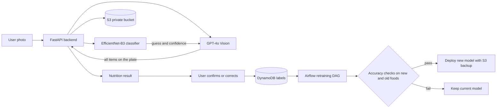

# NutriScan AI

[](https://github.com/Siddhesh-Ai9797/NutriScan---Ai-food-scanner/actions/workflows/ci.yml)

A food nutrition scanner that is live with real users. Take a photo of a meal and get every item on the plate with calories, protein, carbs and fat. The model keeps learning new foods from user feedback through an automated retraining pipeline.

**Live app:** https://nutri-scan-ai-food-scanner.vercel.app

## Results

| Metric | Value |
|---|---|
| Top 1 accuracy, Food-101 test set | 88.46% on 25,250 photos |
| Users | 50+ |
| Photos scanned | about 800 |
| Retraining runs | 8+ in the first 2 months |

## How it works



1. **Classify.** An EfficientNet-B3 model fine tuned on Food-101 makes the first guess.
2. **Verify.** GPT-4o Vision checks every scan. It finds every item on the plate, handles foods the model has never seen, and overrules the model when a confident guess is wrong.
3. **Learn.** A food label is saved only after 3 users agree on it. Once 50 labels collect, an Airflow pipeline retrains the model on the new foods, such as biryani, without forgetting the old ones.
4. **Release safely.** A new model ships only if it passes accuracy checks on both new and old foods. The old model is backed up to S3 and the live app updates automatically.

## Tech stack

| Area | Tools |
|---|---|
| Model | PyTorch, EfficientNet-B3, GPT-4o Vision |
| Backend | FastAPI, Docker, Railway |
| Frontend | Next.js, TypeScript, Tailwind, Vercel |
| MLOps | Airflow, MLflow, AWS S3, AWS Lambda, DynamoDB |
| Auth | Firebase, verified on the server for every request |

## Project structure

```
backend/     FastAPI app, routers, services and tests
frontend/    Next.js app
model/       Training scripts for the base model
pipeline/    Airflow DAG, retraining, evaluation, deployment, Lambda alert
```

## Running locally

```bash
# Backend
cd backend
pip install --extra-index-url https://download.pytorch.org/whl/cpu -r requirements.txt
uvicorn main:app --reload

# Frontend
cd frontend
npm ci
npm run dev
```

The backend reads its settings from a `.env` file in the project root: OpenAI key, AWS region and keys, S3 bucket name, DynamoDB table name, Firebase project id and admin email. The model checkpoint goes in `checkpoints/best_model.pth`.

Or run both with Docker:

```bash
docker compose up --build
```

## Tests

```bash
cd backend
pip install -r requirements-test.txt
python -m pytest -q
```

The tests stub the model, Firebase, OpenAI and AWS, so they run in seconds without any keys. They cover sign in checks, rate limits, admin access, portion scaling, and the logic that decides when GPT-4o overrules the model. GitHub Actions runs them on every push, along with the frontend build and the Docker build.

## Security

* Every API route requires a Firebase sign in, and paid routes have per user limits.
* The S3 bucket is private. Photos are shown through short lived signed links.
* User supplied food names are cleaned before they are stored or used for training.

## Author

Siddhesh Patil, MS in Artificial Intelligence, DePaul University
